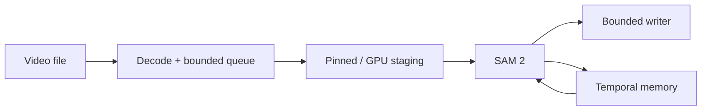

# streamSAM

Track longer videos with SAM 2 without loading every frame into memory first.

[Quick start](#quick-start) · [Python API](#python-api) ·
[How it works](#how-it-works) · [Benchmark guide](benchmarks/README.md)

https://github.com/user-attachments/assets/887fefa0-2245-440e-8012-15dd3cb26fb5

## Longer videos, less host memory

streamSAM processes finite video files frame by frame while carrying SAM 2
temporal state between frames. A 1,000-frame comparison with EdgeTAM:

| Execution strategy | End-to-end FPS | Peak process RSS |
| --- | ---: | ---: |
| Original eager loading | Stopped before inference | 4.5 GiB safety limit |
| Independent 96-frame batches | 17.46 | 4.40 GiB |
| **streamSAM** | **24.49** | **2.52 GiB** |

[Benchmark setup and reproduction](benchmarks/README.md#published-comparison).

Decode, CPU queues, resizing, GPU staging, and output writing are bounded.
**The predictor still retains per-frame results**, so its state can grow as a
video gets longer.

## Quick start

Use Python 3.10 or newer, PyTorch 2.3.1 or newer, and a
[CUDA-capable NVIDIA GPU](https://developer.nvidia.com/cuda/gpus) for the measured
streaming path. The repository includes the EdgeTAM configuration, checkpoint,
and example videos. [uv](https://docs.astral.sh/uv/) installs from the committed
lockfile:

```bash
git clone https://github.com/dej-h/streamSAM.git
cd streamSAM
uv sync --extra gradio
uv run --extra gradio python3 gradio_app.py
```

Upload a video or choose an example, mark the object with an include point,
then click **Track**. The EdgeTAM backbone may download pretrained TIMM weights
on first use.

<details>
<summary>Install with pip</summary>

Install PyTorch for your CUDA version first, then install the package:

```bash
python3 -m pip install -e .
```

For the Gradio demo, install the optional dependencies and start the app:

```bash
python3 -m pip install -e ".[gradio]"
python3 gradio_app.py
```

Pip uses `pyproject.toml` for package metadata and `setup.py` to build the
CUDA extension.

</details>

## Python API

streamSAM keeps the existing `sam2` API and checkpoint format. In an existing
SAM 2 application, enable lazy loading when initializing the predictor state:

```python
state = predictor.init_state(
    video_path="examples/01_dog.mp4",
    frame_loading="lazy",
    offload_state_to_cpu=True,
)
```

Use `add_new_points_or_box` and `propagate_in_video` to prompt and track as
usual. When finished, call `predictor.close_video_source(state)` to release
the frame source and staging workers. The [Gradio app](gradio_app.py) shows
prompt handling and bounded video output together.

EdgeTAM is the currently verified model. The adapter boundaries are intended
to support other SAM 2-family models, but compatibility with those models has
not been validated yet.

## How it works

A lazy frame source feeds a bounded decode queue with backpressure. Frames
pass through reusable pinned CPU memory and GPU staging slots with explicit
CUDA ownership, then enter ordered temporal inference.



Optional one-frame-ahead image feature production overlaps work between frames.
The predict-then-commit API lets an application change a mask before it enters
temporal memory. An asynchronous writer bounds video output.

The [pipeline guide](docs/SAM2_GPU_STREAMING_PIPELINE.md) explains buffer
ownership, CUDA streams, compilation, and measured stage timings. GPU timings,
NVTX ranges, and Perfetto traces support profiling; the
[benchmark guide](benchmarks/README.md) covers matched throughput, memory, and
mask-fidelity checks.

## Run the benchmark

The bundled comparison runs eager loading, independent batches, and streamSAM
on the same source, checkpoint, prompt, dtype, and frame limit:

```bash
uv run --group benchmark python3 -m benchmarks.video.run_benchmark_demo \
  --video examples/01_dog.mp4 \
  --prompt examples/prompts/01_dog.json \
  --max-frames 200 \
  --original-rss-safety-limit-gib 4.5 \
  --playback-speed 2
```

The runner writes raw frame and memory telemetry, subprocess logs, summaries,
and a synchronized replay under `benchmark_artifacts/demo_comparison/`.
The [benchmark guide](benchmarks/README.md) covers measurement tools, video
rendering, and CPU/CUDA contract checks.

## Attribution

streamSAM is derived from Meta's
[EdgeTAM](https://github.com/facebookresearch/EdgeTAM), which is based on
[SAM 2](https://github.com/facebookresearch/sam2). The inherited code, model,
configuration, checkpoint, copyright notices, and Git history remain attributed
to their original authors.

streamSAM is independently maintained and is not affiliated with or endorsed
by Meta.

<details>
<summary>Original authors and research citation</summary>

The original EdgeTAM authors are Chong Zhou, Chenchen Zhu, Yunyang Xiong,
Saksham Suri, Fanyi Xiao, Lemeng Wu, Raghuraman Krishnamoorthi, Bo Dai,
Chen Change Loy, Vikas Chandra, and Bilge Soran.

If you use the EdgeTAM model or checkpoint in research, cite the original work:

```bibtex
@article{zhou2025edgetam,
  title={EdgeTAM: On-Device Track Anything Model},
  author={Zhou, Chong and Zhu, Chenchen and Xiong, Yunyang and Suri, Saksham and Xiao, Fanyi and Wu, Lemeng and Krishnamoorthi, Raghuraman and Dai, Bo and Loy, Chen Change and Chandra, Vikas and Soran, Bilge},
  journal={arXiv preprint arXiv:2501.07256},
  year={2025}
}
```

</details>

## License

streamSAM and the inherited EdgeTAM code are licensed under the
[Apache License 2.0](LICENSE).
